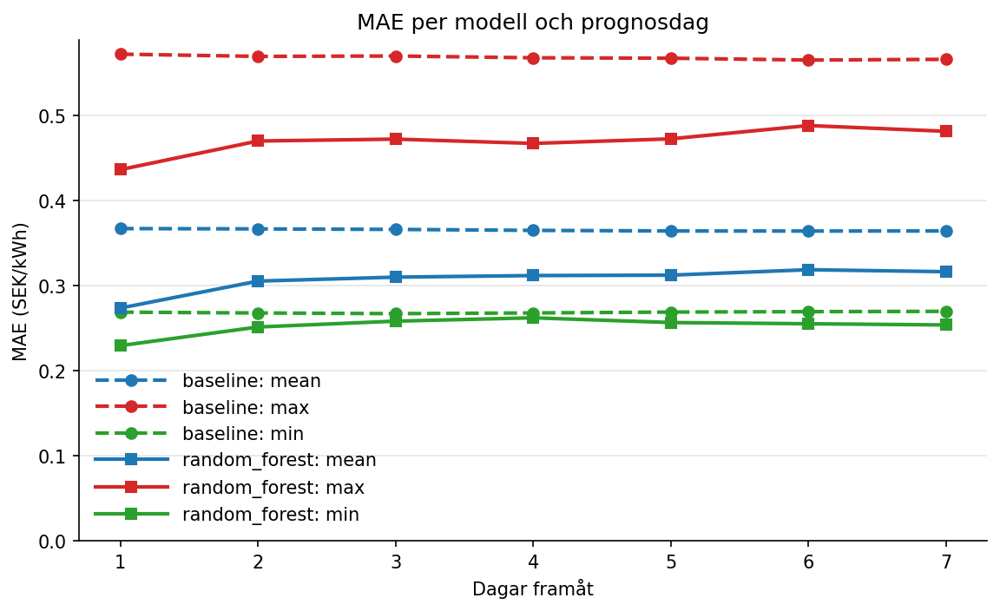

# Elpris SE3 – prognos för spotpriset sju dagar framåt

## Problem och syfte
Prognos för dagens medel, högsta och lägsta spotpris i SE3 för var och en
av de kommande sju dagarna. Prognosen görs varje dag kl. 12.

## Målgrupp
Hushåll med hög elförbrukning, till exempel elbilsägare som vill planera
när de ska ladda.

## Gruppmedlemmar och ansvarsfördelning
- **Isac Reger:** första versionen av datahämtningen, EDA, prognos-CLI (`forecast.py`), README, `docs/datakalla.md` och `docs/utvardering.md`
- **Bilal Mah:** baseline, features, utvärderingsflödet (`evaluate.py`) och resultaten i `results/`
- **Hamed Rezaei:** tidsuppdelning och läckageskydd (`splits.py`), backtest, felanalys och `docs/begransningar.md`
- **Ali Akyel:** repo och GitHub Projects-board, Random Forest, paketering av hämtning/beräkning med tester, versionslåsning och reproducerbarhetskontroll

## Projektplanering
Arbetet planerades och följdes upp i GitHub Projects:
https://github.com/users/smkmrr/projects/1

## Datakälla
Spotpriser för elområde SE3 hämtas från API:et
[Elpriset just nu](https://www.elprisetjustnu.se/elpris-api), som drivs av
Beneficial Apps AS. Datan kommer ursprungligen från ENTSO-E och är fri att
använda om källan anges. Den finns från 1 november 2021 och fram till idag.
Priserna är i SEK per kWh, utan skatt, moms och nätavgifter.

Datan sparas inte i repot. Den hämtas med skriptet i steg 1 under
"Så här kör du", och hämtningsdatumet är den dag skriptet körs.

Begränsningar och detaljer om bearbetningen finns i
[docs/datakalla.md](docs/datakalla.md).

## Projektstruktur

```
data/raw/          rådata från API:et, en JSON-fil per dag (inte i git)
data/processed/    hourly_prices.csv och se3_daily.csv (inte i git)
docs/              datakälla och utvärdering
notebooks/         utforskning (EDA, testupplägg, Random Forest, felanalys)
results/           MAE-tabeller och grafer (skapas av evaluate)
src/elpris/        all kod i projektet
tests/             tester med pytest
```

## Installation
Kräver Python 3.11 eller senare.

```bash
git clone https://github.com/smkmrr/elpris-se3.git
cd elpris-se3
python -m venv .venv
source .venv/Scripts/activate   # Windows (Git Bash)
# source .venv/bin/activate     # macOS / Linux
pip install -e ".[dev]"
pytest
```

## Så här kör du
Kör varje steg från projektets rotmapp, i den här ordningen:

| Steg | Kommando | Resultat |
|---|---|---|
| 1. Hämta priser | `python -m elpris.hamta_elpris` | `data/raw/` (tar 15–20 min första gången, sedan hämtas bara nya dagar) |
| 2. Räkna tim- och dagspriser | `python -m elpris.bygg_priser` | `data/processed/se3_daily.csv` |
| 3. Jämför baseline och Random Forest | `python -m elpris.evaluate` | `results/` |
| 4. Prognos för kommande sju dagar | `python -m elpris.forecast` | tabell i terminalen |

Prognosen använder Random Forest som standard, eftersom den hade lägst MAE i
utvärderingen. Vill du använda baseline i stället:

```bash
python -m elpris.forecast --model baseline
```

## Metod
Varje dag D kl. 12 görs en prognos för dag D+1 till D+7. Då räknas bara
priser till och med dag D som kända, eftersom morgondagens priser
publiceras först omkring kl. 13. Prognosen gäller tre värden per dag:
medelpris, högsta pris och lägsta pris.

**Baseline:** priset för en måldag gissas vara detsamma som samma veckodag
en vecka tidigare. Den är enkel och fungerar som jämförelse.

**Random Forest:** en modell som lär sig av historiken. Den använder
priserna de senaste sju dagarna, medel, högsta och lägsta pris över de
senaste 7 och 14 dagarna, samt veckodag och månad för måldagen och hur
många dagar fram prognosen gäller.

**Utvärdering:** modellen tränas på data före 1 oktober 2025 och testas
på prognosdagarna 1 oktober 2025 – 15 oktober 2026. Mellan träning och test
finns en veckas mellanrum så att ingen framtida information läcker in. Modellerna jämförs med MAE (genomsnittligt absolut fel i SEK/kWh), separat för varje prognosdag 1–7.

## Resultat
Random Forest hade lägre fel (MAE) än baseline för alla tre målvärden och
alla sju prognosdagar under testperioden. Skillnaden är störst dag 1 och
minskar ju längre fram prognosen gäller.

| Målvärde | Dag 1: RF / baseline | Dag 7: RF / baseline |
|---|---|---|
| Dagsmedel | 0,27 / 0,37 (−25 %) | 0,32 / 0,36 (−13 %) |
| Högsta pris | 0,44 / 0,57 (−24 %) | 0,48 / 0,57 (−15 %) |
| Lägsta pris | 0,23 / 0,27 (−15 %) | 0,25 / 0,27 (−6 %) |

MAE i kr/kWh. Alla siffror finns i [results/mae_table.csv](results/mae_table.csv).



Random Forest är inte bättre i alla lägen. På dagar med mycket höga priser
och för lägsta pris på vintern klarade sig baseline lika bra eller bättre,
se Begränsningar.

## Begränsningar
Vad resultaten visar och inte visar, var modellerna missar, begränsningar
i data och metod och när prognosen inte ska användas finns samlat i
[docs/begransningar.md](docs/begransningar.md).

## Användning av generativ AI
Vi har använt Claude och ChatGPT/Codex som stöd i arbetet, främst för att:

- förstå kod, felmeddelanden och begrepp som dataläckage, tidsuppdelning och backtest
- få förslag på kod, tester och dokumentation
- förbättra språket i texter och granska pull requests

All kod har vi själva skrivit in, kört och förstått. Resultaten har vi
kontrollerat genom att köra testerna med pytest, köra projektet från en ren
klon, granska varandras pull requests och jämföra siffror mellan oberoende
implementationer.

## Licens
Koden är licensierad under MIT-licensen, se [LICENSE](LICENSE). Det betyder
att andra får använda och ändra koden om de anger oss som upphovspersoner.

Licensen gäller bara koden. Prisdatan kommer från Elpriset just nu, ligger
inte i repot och omfattas av deras villkor (se Datakälla).


